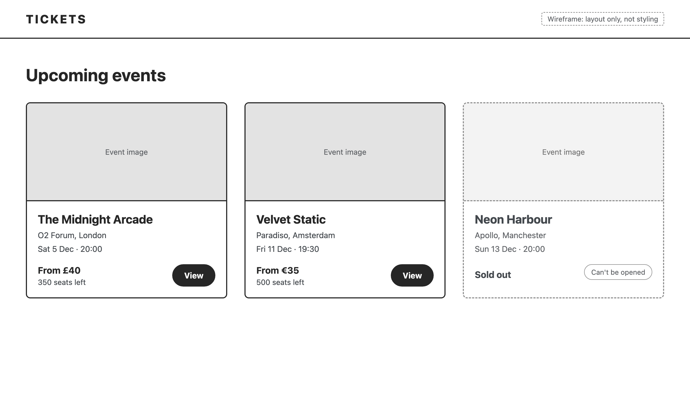
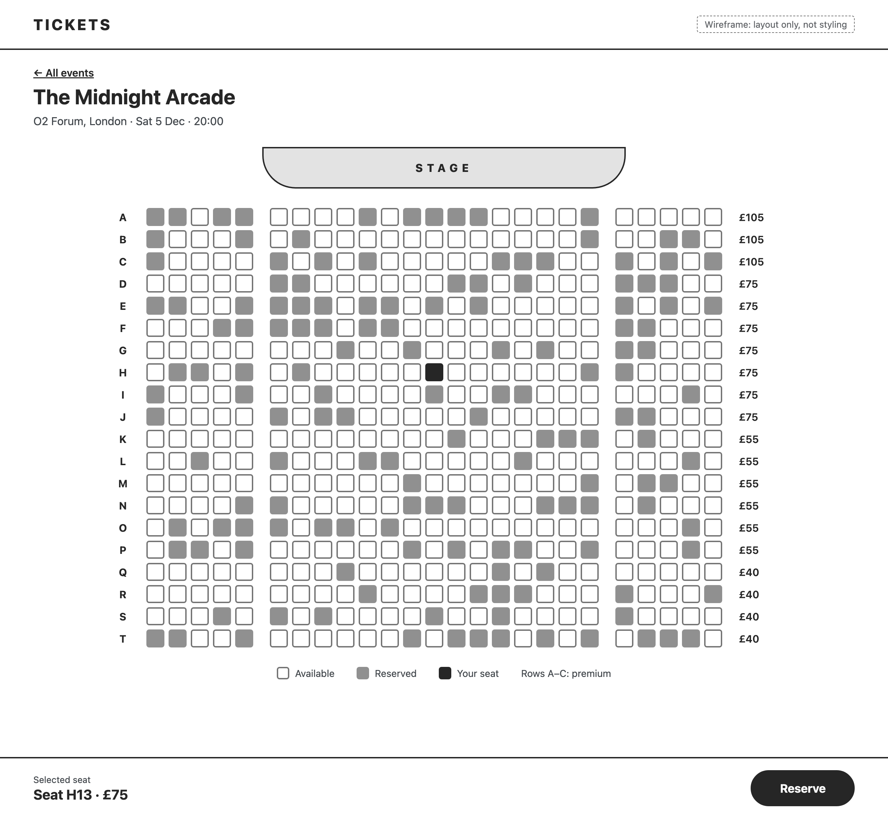
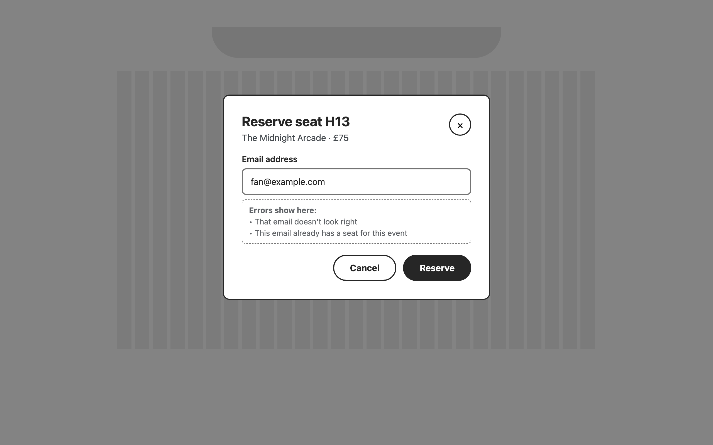
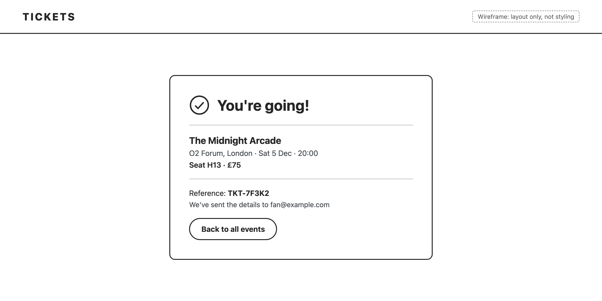

# Product requirements

What Product wants you to build. Routes, labels and technical rules are in [TECHNICAL.md](TECHNICAL.md).

Three pages. The wireframes (in [wireframes/](wireframes/)) show what goes on each page, not how it should look. Styling is up to the team.

## 1. Event directory (`/`)

Fans choose which event they want tickets for.

- Shows every event: name, venue, date and time, lowest price, seats left.
- Selecting an event goes to its seat map page.
- Sold-out events are shown but can't be opened.

## 2. Seat map (`/event/:id`)

Fans choose a seat in a big arena: 500 seats in 20 rows (A–T) of 25, split into a centre block and two wings.

- Shows the event details and all 500 seats in rows, with the stage at the front and aisles between the wings and the centre block.
- The first three rows (A–C) are premium seats and cost a bit more than the rest. Each row shows its price.
- The whole room is visible at once, so fans can compare seats at a glance.
- Each seat shows whether it's available or reserved. Reserved seats can't be selected.
- Fans select one seat. The bar at the bottom shows the selected seat and its price.
- **Reserve** is disabled until a seat is selected. Clicking it opens the pop-up.

**Reserve pop-up**

- Shows the seat, event and price, plus an email field.
- An invalid email shows an error and doesn't submit.
- Each email can only reserve one seat per event. If the email already has a reservation for this event, show an error and don't reserve the seat. The same email can still reserve seats at other events.
- **Reserve** reserves the seat and goes to the confirmation page. **Cancel** or **×** closes the pop-up and keeps the seat selected.

## 3. Confirmation (`/confirmation/:id`)

- Shows the event, seat, price, email and a reservation reference.
- Refreshing the page still shows the reservation.
- No email is actually sent. The copy is enough.
